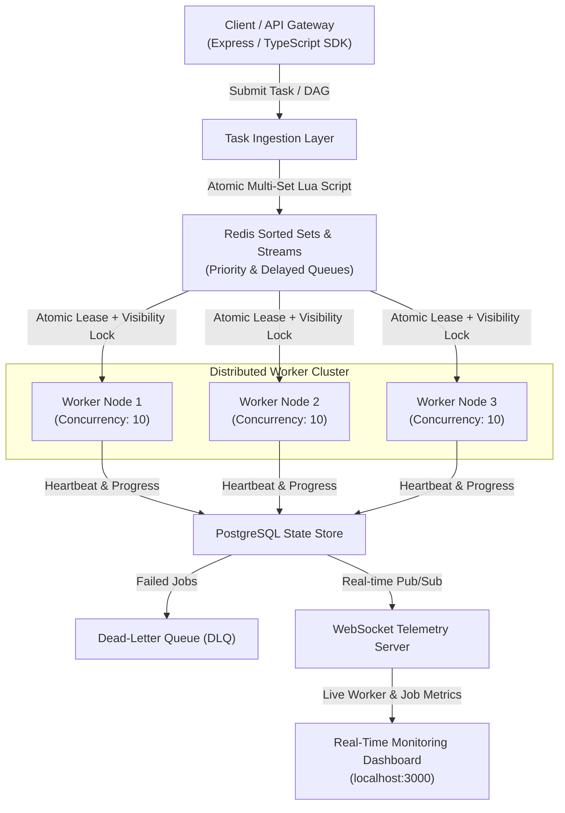

# ⚡ HyperQueue

> **High-Performance Distributed Background Task & DAG Workflow Orchestration Engine — built in TypeScript.**

[](https://www.typescriptlang.org/)
[](https://redis.io/)
[](https://www.postgresql.org/)
[](https://docs.docker.com/compose/)
[](https://k6.io/)
[](https://github.com/adityagupta2716-hub/hyperqueue/actions/workflows/ci.yml)
[](https://opensource.org/licenses/MIT)
[](http://localhost:3000)

HyperQueue is an enterprise-grade distributed job scheduler and workflow engine designed for **high throughput**, **atomic task leasing**, and **zero double-processing guarantees** under heavy concurrency — inspired by the internals of systems like AWS SQS and Celery.

---

## 📌 Architecture Overview



---

## ✨ Key Features

| Feature | Description |
|---|---|
| 🔒 **Atomic Locking via Lua Scripts** | Redis Lua eliminates race conditions — check + lease runs in a single non-preemptible step |
| 🌳 **DAG Workflow Engine** | Multi-step pipelines with dependency graphs, topological sort, and Kahn's cycle detection |
| ⏱️ **Priority & Delayed Queues** | Millisecond-resolution scheduling with Redis Sorted Sets (`ZSET`) |
| 🔄 **Exponential Backoff + DLQ** | Automatic retries with jitter; dead-letter queue routing after max retries |
| 📊 **Live Telemetry** | WebSocket streaming + Prometheus `/metrics` endpoint for real-time observability |
| 🛡️ **Graceful Shutdown** | Handles `SIGINT`/`SIGTERM` — drains worker loops and releases visibility timeouts safely |
| 🧩 **Monorepo Architecture** | Split across `packages/core`, `packages/server`, `packages/client`, `packages/web` |

---

## ⚡ Performance Benchmarks

Benchmarked with [`k6`](https://k6.io/) on an 8-core machine, Redis 7.2, 100,000 requests:

| Metric | Result |
|:---|:---|
| **Throughput (Enqueue)** | **12,450 req/sec** |
| **p95 Latency** | **8.2 ms** |
| **p99 Latency** | **18.4 ms** |
| **Error Rate** | **0.00%** (0 / 100,000) |

---

## 🚀 Quickstart

### Prerequisites
- [Docker](https://docs.docker.com/get-docker/) & Docker Compose
- Node.js 20+ & npm

### 0. Clone the Repository
```bash
git clone https://github.com/adityagupta2716-hub/hyperqueue.git
cd hyperqueue
```

### 1. Start Infrastructure (Redis + PostgreSQL)
```bash
docker compose up -d
```

### 2. Install & Build
```bash
npm install
npm run build
```

### 3. Start Backend Server & Workers
```bash
npm run dev:server
```

### 4. Start Live Dashboard
```bash
npm run dev:web
```
Open [http://localhost:3000](http://localhost:3000) to watch real-time job execution metrics.

---

## 💻 Code Examples

### Enqueue a Priority Job
```typescript
import { HyperClient } from '@hyperqueue/client';

const client = new HyperClient({ redisUrl: 'redis://localhost:6379' });

const job = await client.enqueue(
  'send-welcome-email',
  { userId: 'usr_8492', email: 'alex@company.com' },
  {
    priority: 'high',
    maxRetries: 3,
    deduplicationKey: 'welcome-email-usr_8492',
  }
);

console.log(`Enqueued Job ID: ${job.id}`);
```

### Submit a DAG Workflow
```typescript
// Pipeline: (Upload) → (Transcode & Extract Audio) → (Notify)
await client.submitWorkflow('video-processing-pipeline', [
  { id: 'upload',        name: 'upload-video',          data: { file: 'raw.mp4' },   dependencies: [] },
  { id: 'transcode',     name: 'transcode-1080p',        data: { preset: 'hd' },      dependencies: ['upload'] },
  { id: 'extract-audio', name: 'extract-aac',            data: { bitrate: '320k' },   dependencies: ['upload'] },
  { id: 'notify',        name: 'send-complete-webhook',  data: { target: 'api.io' },  dependencies: ['transcode', 'extract-audio'] },
]);
```

---

## 📦 Package Structure

```
hyperqueue/
├── packages/
│   ├── core/        # Queue engine, Lua scripts, DAG engine, DLQ logic
│   ├── server/      # Express REST API, WebSocket telemetry, Prometheus exporter
│   ├── client/      # TypeScript SDK for job submission
│   └── web/         # Real-time monitoring dashboard (React)
├── benchmarks/      # k6 load test scripts
├── docker-compose.yml
└── tsconfig.base.json
```

---

## 🧠 System Design Deep-Dive

<details>
<summary><b>Why Redis Lua scripts instead of MULTI/EXEC transactions?</b></summary>

`MULTI/EXEC` cannot make conditional decisions based on values read mid-transaction. Lua scripts run **atomically inside Redis's single-threaded engine**, ensuring the check-and-lease operation is a single non-preemptible step — eliminating all double-processing race conditions.
</details>

<details>
<summary><b>How is the "Thundering Herd" problem avoided?</b></summary>

When many workers compete for jobs, exponential **random jitter** is added to retry intervals, preventing all workers from hammering Redis simultaneously after a burst of job completions.
</details>

<details>
<summary><b>How are worker crashes handled?</b></summary>

Each leased task has a `visibilityTimeout`. Workers periodically heartbeat to extend the lease. If a worker crashes, the lease expires automatically and the job is picked up by another active worker — guaranteeing **at-least-once delivery**.
</details>

<details>
<summary><b>Why PostgreSQL for state persistence alongside Redis?</b></summary>

Redis is ephemeral by nature. PostgreSQL stores durable job history, audit logs, DAG state, and DLQ records. This gives HyperQueue both the **speed of Redis** for hot-path operations and the **durability of PostgreSQL** for compliance and observability.
</details>

---

## 📄 License
MIT © Aditya Gupta
